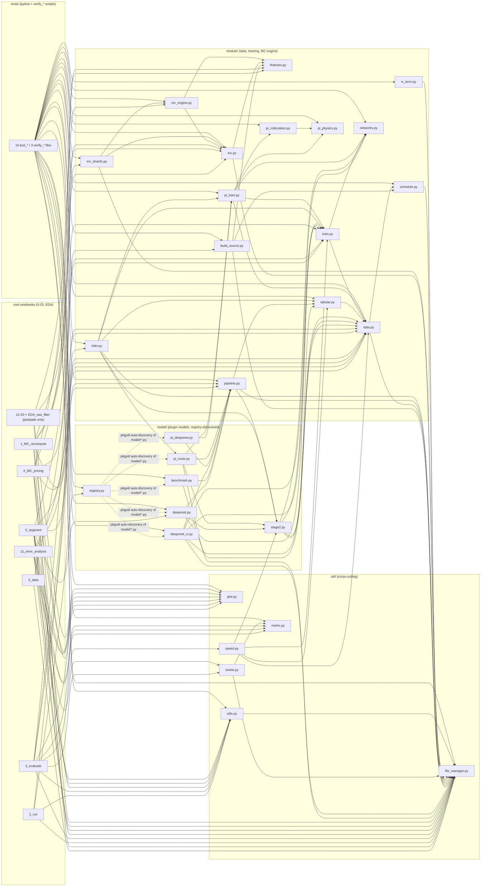

<!-- map-metadata
last-mapped: 0943f8f
generated: 2026-10-16
mode: full
sections: structure, dependencies, conventions, impact
-->

# ARCHITECTURE

> 자동 생성 문서 (`/map`). 수동으로 덧붙일 내용은 `<!-- manual -->` 블록으로 감싸면 다음 갱신 때 보존됩니다.

## Structure

Python research repo (Python 3.11, conda env `abacus`) that trains a **DeepONet / PI-DeepONet surrogate pricer for Korean worst-of step-down autocall ELS**, reproducing a 40,000-path Monte-Carlo theoretical price ~10⁴–10⁵× faster. Dependencies are declared via `requirements.txt` only (no `pyproject.toml`/`setup.py`); all hyperparameters live in a single `config.yaml` and all paths in `util/file_manager.py`.

```
PI-DeepONet-ELS/
├── config.yaml                  # single source of truth for ALL hyperparameters (seed, data.walk_forward,
│                                #   train, networks, physics, tabular, margin)
├── requirements.txt             # only manifest: numpy/pandas/scipy/sklearn, torch 2.9.1, xgb/lgbm/catboost
├── README.md                    # Korean; pipeline, reproduction commands, OOS result table
├── 0_data.ipynb .. 4_MC_pricing.ipynb   # canonical pipeline notebooks (0→4, run top-to-bottom)
├── 5_*.ipynb .. 20_*.ipynb      # ~20 numbered research/ablation notebooks (IV term structure, MC variants,
│                                #   error analysis, contract sensitivity, stage-1 variants)
├── EDA_raw_filter.ipynb         # raw filter funnel + fair-value-ratio / maturity EDA
├── model/                       # model PLUGIN package — auto-discovered by registry
│   ├── registry.py              #   discover()/run_all(): any model/*.py exposing run(D, cfg) is picked up
│   ├── _template.py             #   plugin contract reference (underscore files skipped)
│   ├── benchmark.py             #   direct tabular benchmarks (ridge/gbm/xgb/lgbm/catboost)
│   ├── deeponet.py, deeponet_ci.py, pi_deeponet.py, pi_route.py
│   └── stage2.py                #   hybrid stage-2 residual model
├── module/                      # data + MC engine + networks + train/infer (17 files)
│   ├── build_source.py, data.py, features.py, schedule.py, iv_term.py
│   ├── mc.py, mc_engine.py, mc_shards.py   # MC pricer; mc_shards is the only CLI (shard/combine/monitor)
│   ├── networks.py, train.py, tabular.py, pipeline.py, infer.py
│   └── pi_collocation.py, pi_physics.py, pi_train.py   # physics-informed (PDE) loss + collocation
├── util/                        # file_manager (central paths), utils (config/seed), metric, plot, seeds, speed
├── tests/                       # 16 pytest files (test_*.py) + 3 manual verify_*.py scripts
├── data/                        # cache/ (px_*.parquet, 28 mccal_shard_*.json, KRW curve, div_*) and raw/ (DART
│                                #   CSVs) are the only tracked inputs; *.csv/*.parquet are derived
├── result/                      # predictions/, image/, statistics/, models/ (per-fold weights)
├── docs/                        # Korean design notes + architecture .drawio/.png  (git-ignored)
├── paper/                       # citation list; the PDFs themselves are git-ignored
├── scratch/                     # throwaway scripts/notebooks/logs (git-ignored)
└── experiments/                 # empty (only stale __pycache__)
```

**Key entry points**

- **Pipeline (primary "application")**: notebooks executed in order via nbconvert — `0_data.ipynb` (raw+cache → `data/els3_dataset.parquet`) → `1_MC_recompute.ipynb` (→ `data/ml.csv`, `data/deeponet.csv`) → `2_run.ipynb` (registry auto-discovery → train all models → `result/predictions/` + `result/models/`) → `3_evaluate.ipynb` (load weights → OOS forward → stats/figures) → `4_MC_pricing.ipynb` (MC vs surrogate speed/accuracy). Execute with kernel `els-abacus`.
- **CLI**: `python -m module.mc_shards {shard <i> <N> | gpu | combine 28 | monitor <N> | test}` — the only `__main__` in the codebase. `combine 28` restores the `mc` column from cached shards in seconds instead of ~14 h.
- **Model plug-in seam**: drop a file into `model/` exposing `run(D, cfg) -> {name: DataFrame}`; `model/registry.py` auto-includes it in `2_run.ipynb` (see `model/_template.py`).
- **Tests**: `pytest tests/` from the repo root (no `pytest.ini`/`conftest.py`). `tests/verify_*.py` are standalone verification scripts, deliberately not pytest-collected.

**Code style**: `# -*- coding: utf-8 -*-` header on every module in `module/`/`model/`/`util/`; Korean docstrings describing each function's contract; relative imports inside packages (`from .tabular import fit_tab`) and absolute across packages (`from model.stage2 import ml_resid`); short private helpers prefixed `_`; type annotations essentially unused (`util/file_manager.py` is the exception); paths always resolved through `util.file_manager` rather than literals.

## Dependencies

**Language:** Python 3.11 only. Single manifest: `requirements.txt`. No `pyproject.toml`/`setup.py` — the three first-party packages (`model/`, `module/`, `util/`) are imported as top-level packages from the repo root, so **the repo root is the import root**. Runtime config is `config.yaml`, loaded through `util/utils.py:load_config()`.

**Scope of this map:** first-party imports in `model/`, `module/`, `util/`, `tests/` and the 23 root-level notebooks. `scratch/` (166 `.py` files plus a forked copy of the project at `scratch/PI-DeepONet-corrected-PDE-only/`) is git-ignored throwaway work and is excluded — including it would roughly triple the fan-in on `util/file_manager.py` and `module/data.py` without changing the ranking. `experiments/` contains only stale `.pyc` files with no surviving source.

166 unique edges across 28 first-party modules; 24 modules have fan-in ≥ 2 (under the 30 threshold, so all are shown).

### Dependency graph (fan-in ≥ 2)



**Cycle to note:** `module/pipeline.py` → `model/stage2.py` → `module/{data,networks,tabular,train}.py` is a package-level cycle between `module` and `model`, deepened by `module/infer.py` → `model/pi_route.py` → `module/pipeline.py` → `model/stage2.py`. `module/infer.py:100` defers `from model.pi_route import load_routed_predictor` into a function body, which is what keeps it importable. This is the structural weak point of the layering: `module/` is nominally the lower layer but reaches up into `model/`.

### External dependencies

| Package (pin) | Purpose | Used by |
|---|---|---|
| `numpy==2.3.0` | array math everywhere; MC path generation | 38 files — all of `module/`, `model/`, `util/`, `tests/`, every notebook. Beware the known `cumsum(out=…)` leak on this version |
| `pandas==2.3.0` | dataset frames, parquet I/O, prediction tables | 27 files: most of `module/`, `model/{deeponet_ci,pi_route}.py`, `util/{metric,seeds,speed}.py`, most tests and notebooks |
| `torch==2.9.1` | DeepONet/PI-DeepONet nets, autograd PDE residuals, GPU MC engine | `module/{networks,train,data,pi_train,pi_collocation,pi_physics,mc_engine}.py`, `model/{stage2,deeponet_ci}.py`, `util/utils.py`, 2 tests, notebooks 4/5 |
| `scikit-learn==1.7.1` | ridge/HistGB baselines, preprocessing pipeline, R²/MAE metrics | `module/tabular.py`, `util/metric.py`, `util/plot.py`, 1 verify script, notebooks 3/5/13-18 |
| `xgboost==3.2.0` | stage-1 XGB anchor and stage-2 residual (canonical margin model) | `model/benchmark.py`, `model/stage2.py`, `module/tabular.py`, `util/speed.py`, `5_segment.ipynb` |
| `lightgbm==4.6.0` | GBM benchmark arm | `module/tabular.py` only |
| `catboost==1.2.10` | GBM benchmark arm | `module/tabular.py` only (plus the stray `catboost_info/` dir at root) |
| `matplotlib==3.9.2` | all figures; `util/plot.py` sets global academic/PPT rcParams on import | `util/plot.py`, 1 verify script, ~20 notebooks (all via `from util import plot as _plot`) |
| `PyYAML==6.0.2` | reads `config.yaml` | `util/utils.py` only (single `yaml.safe_load`) |
| `pyarrow==20.0.0` | parquet engine — never imported directly, used through `pandas.read_parquet`/`to_parquet` | `module/{build_source,data,iv_term,mc,mc_shards,pi_train}.py`, `util/file_manager.py`, 4 tests |
| `ipykernel`, `nbconvert`, `jupyter-core` | notebook execution toolchain (kernel `els-abacus`) | not imported in source; used by the CLI pipeline that runs `0_data` → `4_MC_pricing` |

**Imported but missing from `requirements.txt`:**

| Package | Purpose | Used by |
|---|---|---|
| `scipy` | `spearmanr`, `norm` for rank metrics and IV inversion | `util/metric.py`, `util/plot.py`, notebooks 5/5_segment |
| `joblib` | pickling fitted sklearn/XGB models per walk-forward fold | `model/stage2.py`, `module/infer.py`, `module/tabular.py` (arrives transitively via scikit-learn) |
| `pytest` | test runner | 9 `tests/test_*.py` files |
| `yfinance` | dividend/price cross-check against cached `px_*` | `tests/verify_px_yfinance.py`, `19_yfinance_dividend_check.ipynb` |
| `statsmodels` | OLS on causal increments | `13_causal_increments.ipynb` |
| `numba` | JIT MC loop variant | `4_MC_pricing.ipynb` |

`requirements.txt` also mislabels the notebook chain as "0_data / 1_run / 2_evaluate / 3_validate"; the actual entry points are `0_data` / `1_MC_recompute` / `2_run` / `3_evaluate` / `4_MC_pricing`.

### Key interfaces (top 10 by fan-in)

1. **`util/file_manager.py` (35)** — central path registry (`ELSDirectoryPath` class + module-level `ROOT`/`dataset()`/`prediction()` shims returning `pathlib.Path`); every data/result read or write goes through it, making it the single most load-bearing file in the repo.
2. **`module/data.py` (17)** — dataset schema and loader: splits features into branch (basket vol/corr + yield curve) vs trunk (full STRK schedule, barriers, coupons, maturity), plus `zstats`/`znorm`/`to_tensor`/`time_weights` used by every trainer.
3. **`util/plot.py` (15)** — figure library; importing it mutates global matplotlib rcParams to dpi-400 / transparent / 13.333×5.0 in PPT band, so it is an implicit side-effecting dependency of every notebook that saves a figure.
4. **`module/pipeline.py` (10)** — walk-forward OOS assembly: `predict_hybrid`, `predict_direct_tab`, `hybrid_residual_target`; the contract every `model/*.py` plugin is built on, and the source of the `module` → `model` cycle.
5. **`module/train.py` (10)** — stage-1 anchor training (`train_curve` for DeepONet-Curve) and the shared `_EarlyStop`/`_opt` primitives reused by `model/stage2.py` and `module/pi_train.py`.
6. **`util/utils.py` (7)** — `load_config()` (cached `config.yaml`), seed fixing, device selection.
7. **`module/mc.py` (7)** — legacy numpy MC pricer, explicitly retired for production but kept as the reference for reproducing the existing `mc` column and for engine cross-checks.
8. **`util/metric.py` (6)** — R²/MAE/RMSE/Spearman plus `metrics_by` and `stage_r2` for per-stage hybrid reporting.
9. **`module/mc_engine.py` (5)** — torch/CUDA MC engine; the canonical payoff-rule implementation (vectorized worst-of in log space, ~27 ms/product).
10. **`module/features.py` (5)** — shared feature derivation (KRW Nelson-Siegel curve, 180-day historical vol/corr), kept identical between `build_source` and MC recompute for reproducibility.

Just below the cut: **`model/stage2.py` (5)** — all stage-2 residual models (`ml_resid` default, `xgb_resid`, `don_resid`); **`module/networks.py` (5)** — `CurveOperatorV2` / `MarginOperator` / `PIStateDeepONet`; **`module/tabular.py` (5)** — the config-driven ridge/HistGB/LGBM/XGB/CatBoost regressor factory.

**`model/registry.py` (3)** deserves special mention despite low static fan-in: it uses `pkgutil.iter_modules` + `importlib` to auto-discover every `model/*.py` exposing `run(D, cfg)`, so the dotted edges in the graph are **dynamic, not greppable**.

Notebooks `5_MC_implied_vol`, `6_IV_vs_HV`, `7_methodology_bakeoff`, `8_bates_vs_historical`, `9_stage2_iv_ablation`, `10_iv_ablation_two_anchors` import no first-party module at all — they are self-contained analyses reading cached CSV/parquet directly, so they do not appear in the graph.

## Conventions

### Patterns

- **Four-layer repo with notebooks as the only orchestration.** `util/` (paths, config, metrics, plots, seeds, speed) → `module/` (data schema, features, MC engines, networks, train, pipeline, infer) → `model/` (model plugins) → numbered root notebooks. `0_data` → `1_MC_recompute` → `2_run` → `3_evaluate` → `4_MC_pricing` is the canonical reproduction chain; notebooks `5_*`–`20_*` are one-question ablation notebooks that are kept, not deleted, with the accepted answer folded back into `config.yaml`/`module/` and the rejected one recorded as a comment.
- **Plugin-registry contract for models.** A file in `model/` that exposes `run(D, cfg) -> dict[str, pandas.DataFrame]` is auto-discovered by `model/registry.py` (`pkgutil.iter_modules`, sorted by name; modules starting with `_` and `registry` skipped) and joins `2_run` with no pipeline edits; duplicate prediction names raise `ValueError`. `model/_template.py` is the executable spec of that contract.
- **Two single sources of truth, no literals.** Every path flows through `util/file_manager.py`; every hyperparameter flows through `config.yaml` via `util.utils.load_config()` (cached). Feature lists are deliberately *not* in config — they live in `module/data.py` (noted in `config.yaml`'s header).
- **A single `D` bundle plus fixed artifact schemas.** `module.data.load` returns a `SimpleNamespace` (`D.WF` walk-forward `(tr, va, te)` index folds, `D.MC`, `D.FAIR`, `D.rm`, `D.VC/CURVE/CON`, `D.DEV`), all arrays `float32`. Predictions land at `result/predictions/<name>.csv` with `ITEM_CD, isu_ord, y_true, y_pred` (+ `mc_true, mc_pred, resid_true, resid_pred` for 2-stage hybrids, which is exactly what `util.metric.stage_r2` probes), per-fold weights at `result/models/<name>_fold{k}.{pt|pkl}` via `module/pipeline.py::_mp`.
- **Docstrings are design memos, not API blurbs.** Korean module/function docstrings state *why*, name the rejected alternative, and quote the measured delta — e.g. `module/data.py` ("`regime` 은 OOS 외삽 실패 → 상대신호만", "빼면 +0.004"), `module/mc_shards.py` ("무보정 k=1 정본"), `util/seeds.py` (seed sd ≈ 0.0137 ⇒ all metrics must be 5-seed mean ± sd).
- **Expensive jobs are `python -m` CLI modules.** `module/mc_shards.py` parses `sys.argv` in `main()` with subcommands `shard | gpu | combine | monitor | test`, pins `OMP/OPENBLAS/MKL/NUMEXPR_NUM_THREADS=1` at import (Windows OOM avoidance), does `sys.path.insert(0, repo_root)` for direct execution, caches results as `data/cache/mccal_shard_<k>.json`, and writes progress heartbeats to `scratch/mc_progress/`.
- **Flat module-level functions with `_`-prefixed private helpers** (`_anchor`, `_anchor_l1`, `_mp`, `_save`, `_tasks`, `_load_source`, `_sort_best_first`). Classes appear only for paths and `torch.nn` modules. Callback-returning factories are the reuse seam: `anchor_fn(D,cfg,tr,va,te,save_path=) -> predict(idx)` and `resid_fn(...) -> (resid_tr, resid_te)`.

### Configuration

- **No linter, formatter, type-checker, or packaging config exists** — no `pyproject.toml`, `setup.cfg`, `.flake8`, `.pylintrc`, `ruff.toml`, `.editorconfig`, mypy config. The project is not installable; imports assume cwd = repo root, or an explicit `sys.path.insert` at the top of scripts/tests.
- **No CI, no Makefile, no Dockerfile/compose, no `.env`, no `.github/`.** Automation is nbconvert, documented in `README.md`: `jupyter nbconvert --to notebook --execute --inplace N_*.ipynb` run in numeric order (the one heavy step, MC shard computation, is split out and normally restored from the 28 cached shards with `python -m module.mc_shards combine 28`).
- **`requirements.txt` pins exact versions** (`numpy==2.3.0`, `torch==2.9.1`, `xgboost==3.2.0`, …) grouped by purpose with `# ---` banner comments and prose caveats (CUDA 12.8 build, CPU fallback). Target is Python 3.11 in conda env `abacus`. Notebook kernelspec on disk is plain `python3`, but execution requires kernel `els-abacus`.
- **`config.yaml` is the one hyperparameter file**, organized into `data / train / networks / physics / tabular / margin` blocks with a Korean trailing comment on nearly every key documenting allowed values and the reason for the default (e.g. `feature_set: driver  # base|regime|driver (regime은 OOS 외삽 실패)`, `half_life: auto`, `loss: reg:pseudohubererror`).
- **`.gitignore` encodes the "inputs vs derivatives" rule**: only `data/raw/` and `data/cache/` are inputs; `data/els3_dataset.parquet`, `data/ml.csv`, `data/deeponet.csv`, `result/`, `docs/`, `scratch/`, `catboost_info`, `__pycache__` and the vendored agent dirs are all ignored.
- **De facto code style** (enforced by habit only): `# -*- coding: utf-8 -*-` as line 1 of every file in `module/`, `model/`, `util/` (35 of 52 `.py` files; most tests omit it), 4-space indent, double quotes, long lines accepted (130–168 chars — no 79/88 budget), imports ordered stdlib → third-party → local with `from . import features as F` inside a package and `from util import file_manager as fm` across packages. Type hints essentially unused (5 return annotations across 209 defs) — types are documented in docstrings instead.

### Established Practices

- **Korean prose, English figures.** All comments, docstrings, assertion messages and exception strings are Korean; English is reserved for identifiers, metric column names (`R2`, `MAPE%`, `Bias%`, `Spearman`) and every piece of text that reaches a figure — `util/plot.py` opens with "그래프 (전부 영문 텍스트)". Importing `util.plot` mutates global `rcParams` so any `savefig` is PPT-ready; each plot function takes `path=None`, saves, and returns `fig`.
- **Fail fast with actionable Korean errors; catch almost nothing.** 14 `raise` sites (`ValueError`, `FileNotFoundError`, `KeyError`) with remediation baked into the message ("먼저 shard 로 MC 를 계산하세요", "0_data build_source 재실행 필요"); `assert` guards dataset schema in `module/data.py`. Only three `except` blocks exist repo-wide, each for one specific recoverable case (`np.linalg.LinAlgError` → PSD-repaired Cholesky in `module/features.py`, unreadable heartbeat JSON, per-row build failure).
- **Tests are plain pytest functions that encode past bugs.** `tests/test_*.py`, module-level `def test_...` (no classes, no `conftest.py`), each file opening with `sys.path.insert(0, <repo root>)`. Assertions carry Korean explanations, and regression tests first prove the old failure before asserting the fix (`tests/test_znorm.py`: `assert abs(raw[9,0]) > 1e6, "재현 실패: 원래는 폭주해야 한다"`). `tests/verify_*.py` are deliberately *not* pytest-collected: manual scripts with `main()`, a CLI sample-size argument, and numeric pass thresholds as module constants.
- **Leak-freedom is structural, not checked after the fact.** Expanding walk-forward folds with the test window always in the future, validation sampled only inside each fold's train block, as-of/causal features only (the `DRIVER` set exists because absolute-level `REG` features failed OOS), normalization statistics computed on train indices only (`zstats(a, tr)`) with clipping (`ZCLIP`) for constant train columns.
- **Numbers never appear inline twice.** Magic constants are hoisted to module level and commented with their source (`NPATH`, `VOL_WIN=180`, `CORR_WIN=180`, `EWMA_SPAN=120`, `FACE=10000`, `LAM=1.5`, `SE=0.0015`, `SEEDS=(0,1,2,3,4)`, `DPI=400`). Reproducibility is routed through `util.utils.set_seed` plus `util/seeds.py`, which **refuses to report a model that lacks all five seed CSVs** rather than mixing single-seed numbers in.
- **DRY across the pipeline/MC boundary is explicit.** `module/features.py` is shared by `0_data` and every MC-recompute notebook so curve/vol definitions stay identical to the original pricer; `module/mc_engine.py` is declared "페이오프 규칙의 정본 구현" and exposes `payoff_from_path_summary_t` purely so the physics loss can be tested against it; MC variants get their own caches while the canonical `mc` stays untouched.
- **Commits: Conventional-Commit type in English, subject in Korean**, with a feature or notebook scope — `feat(mc):`, `refactor(notebook5):`, `fix(stage2):`, `chore(evaluate):`, `test(repro):`. Work happens on `feat/<topic>` branches off `main`.

## Impact Analysis

Derived from the dependency graph above (fan-in counts in parentheses).

### High-coupling zones (fan-in ≥ 3)

Changing any of these ripples widely. Touch with a test run, not a spot check.

| Module | Fan-in | Blast radius |
|---|---|---|
| `util/file_manager.py` | 35 | **Everything.** Every read/write in the repo. A path rename breaks all four notebook stages, all tests, all of `scratch/`. |
| `module/data.py` | 17 | Dataset schema + `zstats/znorm/to_tensor`. Changing column order or the branch/trunk split silently invalidates **every saved weight** in `result/models/`. |
| `util/plot.py` | 15 | Side-effecting: import mutates global rcParams. Every figure-producing notebook. |
| `module/pipeline.py` | 10 | The plugin contract. Breaks every `model/*.py` arm at once; also the `module`→`model` cycle anchor. |
| `module/train.py` | 10 | Stage-1 anchors + shared `_EarlyStop`/`_opt`. Breaks `model/stage2.py` and `module/pi_train.py` together. |
| `util/utils.py` | 7 | `load_config()` + seeding + device. Breaks reproducibility of every run. |
| `module/mc.py` | 7 | Reference MC pricer. Changing it invalidates the `mc` column reproduction and the engine cross-check. |
| `util/metric.py` | 6 | All reported numbers, including `stage_r2`. |
| `module/mc_engine.py` | 5 | Canonical payoff rule. Any change must be re-validated against `module/mc.py` via `tests/verify_engine_agreement.py`. |
| `module/features.py` | 5 | **Shared deliberately** between `build_source` and MC recompute. A change here desynchronizes the dataset from the pricer — the one coupling the codebase wants. |
| `model/stage2.py` | 5 | Every hybrid arm's residual stage; also inside the cycle. |
| `module/networks.py` | 5 | All torch architectures; changes invalidate saved `.pt` weights. |
| `module/tabular.py` | 5 | The regressor factory for all five tabular backends. |
| `module/pi_train.py` | 4 | Physics-informed training; `model/{pi_deeponet,pi_route}.py` + `module/infer.py`. |
| `module/schedule.py` | 4 | Contract schedule parsing; feeds `data.py` and `build_source.py`. |
| `module/mc_shards.py` | 3 | The only CLI; the 28-shard cache contract. |
| `model/registry.py` | 3 | Auto-discovery. A contract change silently drops model arms from `2_run` **without an error**. |
| `model/deeponet.py` | 3 | The headline model arm. |
| `module/pi_physics.py` | 3 | PDE residual definition. |

### Critical paths

1. **Data build** — `0_data.ipynb` → `module/build_source.py` → `module/features.py` + `module/schedule.py` → `util/file_manager.py`. `features.py` is also reached by `mc.py`/`mc_engine.py`, so a change here hits the dataset *and* the pricer simultaneously. This is intentional (reproducibility), and it means feature edits are never local.
2. **Train** — `2_run.ipynb` → `model/registry.py` ⇢ *(dynamic)* `model/*.py` → `module/pipeline.py` → `model/stage2.py` → `module/{data,networks,tabular,train}.py` → `util/file_manager.py`. The dynamic hop is invisible to grep, and the `pipeline ↔ stage2` cycle means `module/` cannot be reasoned about without `model/`.
3. **MC price** — `python -m module.mc_shards` → `module/mc_engine.py` → `module/mc.py` → `module/features.py` → `util/file_manager.py`, with results landing in `data/cache/mccal_shard_*.json`. The cache *is* the MC result; `combine 28` is the reproduction path.

### Safe zones

Low blast radius — edit freely.

- **Root notebooks** (fan-in 0 — nothing imports a notebook). `5_MC_implied_vol`, `6_IV_vs_HV`, `7_methodology_bakeoff`, `8_bates_vs_historical`, `9_stage2_iv_ablation`, `10_iv_ablation_two_anchors` are fully self-contained (no first-party imports at all).
- **`scratch/`** — git-ignored, imported by nothing tracked.
- **Leaf modules** (fan-in 1): `util/speed.py` (only `3_evaluate`), `model/pi_route.py` (only `module/infer.py`, via a deferred import), `model/deeponet_ci.py` (only tests), `module/iv_term.py` (only tests).
- **New model arms** — adding a `model/*.py` with `run(D, cfg)` touches nothing else by construction. This is the intended extension seam.

### Known structural debt

1. **`module` ↔ `model` import cycle** via `pipeline.py` → `stage2.py`, held together only by the deferred import at `module/infer.py:100`. The nominal lower layer reaches up into the upper one.
2. **Dynamic model discovery is not greppable** — `model/registry.py` enrolls arms via `pkgutil`, so a dropped or renamed arm vanishes from `2_run` without raising.
3. **`util/plot.py` mutates global state on import** — any module importing it inherits dpi-400/transparent rcParams whether it wants them or not.
4. **`requirements.txt` is incomplete** (`scipy`, `joblib`, `pytest`, `yfinance`, `statsmodels`, `numba` missing) and its notebook-chain comment is stale.
5. **`experiments/`** holds only orphan `.pyc` files with no surviving source.
