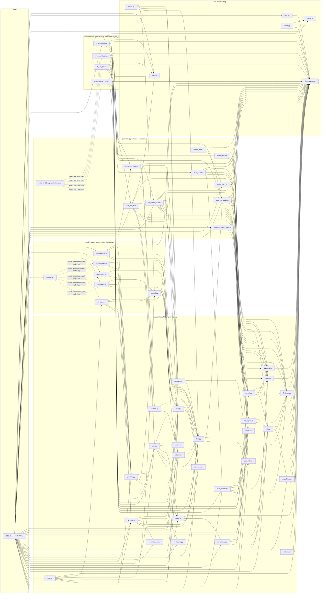

<!-- map-metadata
last-mapped: a2b557b
generated: 2026-10-16
updated: 2026-10-18 (by hand — the /map run predates the tools/->generate/ rename,
                     the black+annotation pass, and the notebook consolidation)
mode: full
sections: structure, dependencies, conventions, impact
-->

# ARCHITECTURE

> 자동 생성 문서 (`/map`). 수동으로 덧붙일 내용은 `<!-- manual -->` 블록으로 감싸면 다음 갱신 때 보존됩니다.

## Structure

Python research repo (Python 3.11, conda env `abacus`) that trains a **DeepONet surrogate pricer for
Korean worst-of step-down autocall ELS**, reproducing a 100,000-path Monte-Carlo theoretical price
~10⁴× faster. Dependencies are pinned in `requirements.txt`; `pyproject.toml` carries **formatter
settings only** (black, 100 columns) — the project is still not installable, so the repo root is the
import root. All hyperparameters live in a single `config.yaml` and all paths in
`util/file_manager.py`.

```
PI-DeepONet-ELS/
├── config.yaml                  # single source of truth for ALL hyperparameters (seed, data.walk_forward,
│                                #   train, networks, physics, tabular, margin)
├── pyproject.toml               # [tool.black] line-length = 100 — nothing else; NOT a package manifest
├── requirements.txt             # pinned deps: numpy/pandas/scipy/sklearn, torch 2.9.1, xgb/lgbm
├── README.md                    # Korean; pipeline, input schema of the headline model, reproduction, code map
├── 0_data_preprocessing.ipynb   # raw -> data/els3_dataset.parquet + drop funnel / distributions
├── 1_MC_pricer.ipynb            # MC labels (both variants), bitwise reproduction check, path noise
├── 2_model_training.ipynb       # trains 7 arms x 5 seeds x 4 folds -> result/models/ (140 weights)
├── 3_visualization.ipynb        # all 24 figures in 4 categories + 13 tables
├── module/                      # data + MC engine + networks + train/infer  (27 files)
│   ├── build_source.py, data.py, schedule.py, features.py, iv_term.py, contract.py
│   ├── underlying.py, dividend.py, curve.py, market.py   # source-only input adapters
│   ├── mc.py, mc_engine.py, mc_shards.py, mcvar.py, seeds.py, star.py, vbase.py
│   ├── networks.py, train.py, tabular.py, pipeline.py, infer.py, anchors.py
│   └── pi_collocation.py, pi_physics.py, pi_train.py     # physics-informed (PDE) loss + collocation
├── model/                       # model PLUGIN package — auto-discovered by registry  (9 files)
│   ├── registry.py              #   discover()/run_all(): any model/*.py exposing run(D, cfg) is picked up
│   ├── _template.py             #   plugin contract reference (underscore files skipped)
│   ├── benchmark.py             #   direct tabular benchmarks (ridge/gbm/lgbm/xgb)
│   ├── deeponet.py, deeponet_ci.py, pi_deeponet.py, pi_route.py
│   └── stage2.py                #   hybrid stage-2 residual models
├── util/                        # file_manager (central paths), utils (config/seed), metric, plot, seeds, speed
├── generate/                    # GENERATORS — every tracked artifact is produced here  (15 files)
│   ├── build_nb_{data,pricer,training,viz}.py   # the four notebooks are generated, never hand-edited
│   ├── build_mc_variants.py, build_12star.py, build_decomp.py, mc_check_12star.py
│   ├── eval_all_stars.py, eval_cross_section.py, measure_source_switch.py
│   └── verify_raw_run.py, freeze_verdict.py, stash_for_raw_run.py
├── tests/                       # 50 pytest files + 4 manual verify_*.py scripts
│   └── fixtures/                #   raw_run_verdict.json — the reproduction verdict's evidence,
│                                #   tracked on purpose so the baseline snapshot can be deleted
├── data/                        # git-ignored. data/raw/ + data/share_underlyings_v2/ are the ONLY inputs;
│                                #   cache/, *.parquet, *.csv are all derived and regenerated by notebook 0/1
├── result/                      # git-ignored except the two figures README embeds
├── docs/                        # Korean design notes + plans + architecture .drawio/.png  (git-ignored)
├── paper/                       # reference PDFs  (git-ignored; citation list is in README)
└── scratch/                     # throwaway scripts/notebooks/logs (git-ignored)
```

**Key entry points**

- **Pipeline (primary "application")**: four notebooks executed in order via nbconvert —
  `0_data_preprocessing` (raw → `els3_dataset.parquet`, `els12_dataset.parquet`, `ml.csv`,
  `deeponet.csv`) → `1_MC_pricer` (→ `data/cache/mcvar/mc_variants*.parquet`, the MC labels) →
  `2_model_training` (→ `result/models/` 140 weights + `nb_training_level.csv`) → `3_visualization`
  (→ 24 figures + 13 tables). Execute with kernel `els-abacus`. Each notebook skips work whose
  output already exists **and whose provenance stamp matches**; `REBUILD = True` / `RETRAIN=1` force it.
- **Reproduction claim**: with only `data/raw/` and `data/share_underlyings_v2/` present, the four
  notebooks rebuild everything (verified: 0 errors, bitwise label check 0.00e+00 KRW). Total ~200 min,
  dominated by notebook 1.
- **CLIs**: 15 modules have a `__main__` — `module/mc_shards.py`
  (`shard | gpu | combine | monitor | test`) plus all 14 `generate/*.py`. The generators are what the
  notebooks call, so running them directly is the way to rebuild one artifact without a notebook.
- **Model plug-in seam**: drop a file into `model/` exposing `run(D, cfg) -> {name: DataFrame}`;
  `model/registry.py` auto-includes it (see `model/_template.py`).
- **Tests**: `pytest` from the repo root (no `pytest.ini`/`conftest.py`) — 262 passed, 29 skipped,
  ~42 s. `tests/verify_*.py` are standalone scripts, deliberately not pytest-collected.

**Code style**: `# -*- coding: utf-8 -*-` header on every module; **black at 100 columns**
(`pyproject.toml`, also read by the `ms-python.black-formatter` editor extension); Korean docstrings
on **every** function (356/356) and class (8/8), written as design memos with explicit `입력`/`출력`
blocks; **complete type annotations** (849/849 parameters, 356/356 returns) deliberately *without*
`from __future__ import annotations`, so a bad annotation fails at import rather than hiding in a
string; relative imports inside packages (`from .tabular import fit_tab`) and absolute across them
(`from model.stage2 import ml_resid`); short private helpers prefixed `_`; paths always resolved
through `util.file_manager`.

## Dependencies

**Language:** Python 3.11 only. Deps pinned in `requirements.txt`; `pyproject.toml` configures black
and nothing else. The four first-party packages (`module/`, `model/`, `util/`, `generate/`) are
imported as top-level packages from the repo root, so **the repo root is the import root**. Runtime
config is `config.yaml`, loaded through `util/utils.py:load_config()`.

**Scope of this map:** first-party imports in `module/`, `model/`, `util/`, `generate/`, `tests/` and
the four root notebooks. `scratch/` is git-ignored throwaway work and is excluded — including it would
roughly triple the fan-in on `util/file_manager.py` and `module/data.py` without changing the ranking.

### Dependency graph (fan-in ≥ 5)



**Two cycles to note.**

1. `module/pipeline.py` → `model/stage2.py` → `module/{data,networks,tabular,train}.py` is a
   package-level cycle between `module` and `model`, deepened by `module/infer.py` →
   `model/pi_route.py` → `module/pipeline.py`. `module/infer.py` defers
   `from model.pi_route import load_routed_predictor` into a function body, which is what keeps it
   importable. `module/` is nominally the lower layer but reaches up into `model/`.
2. `module/data.py:datasets_stale()` imports `generate.build_mc_variants` for the provenance-stamp
   comparison, and `generate/build_mc_variants.py` imports most of `module/`. Same inversion, newer:
   the stamp rule's canonical implementation sits in the generator layer. The import is inside the
   function body, and the docstring says so. Moving `stamp_differs` down into `module/` would fix it.

### External dependencies

| Package (pin) | Purpose | Used by |
|---|---|---|
| `numpy==2.3.0` | array math everywhere; MC path generation | all of `module/`, `model/`, `util/`, `generate/`, `tests/`. Beware the known `cumsum(out=…)` leak on this version |
| `pandas==2.3.0` | dataset frames, parquet I/O, result tables | most of `module/` and `generate/`, `model/{deeponet_ci,pi_route}.py`, `util/{metric,plot,seeds,speed}.py`, most tests |
| `torch==2.9.1` | DeepONet nets, autograd PDE residuals, GPU MC engine | `module/{networks,train,data,pi_train,pi_collocation,pi_physics,mc_engine,vbase}.py`, `model/{stage2,deeponet_ci}.py`, `util/utils.py` |
| `scikit-learn==1.7.1` | ridge/HistGB baselines, preprocessing pipeline, R²/MAE metrics | `module/tabular.py`, `util/metric.py`, `util/plot.py` |
| `xgboost==3.2.0` | stage-1 XGB anchor and stage-2 residual | `model/{benchmark,stage2}.py`, `module/tabular.py`, `util/speed.py` |
| `lightgbm==4.6.0` | GBM benchmark arm | `module/tabular.py` only |
| `scipy==1.16.0` | `brentq` (IRS bootstrap), `spearmanr`, `norm` | `module/curve.py`, `util/{metric,plot}.py` |
| `matplotlib==3.9.2` | all figures; `util/plot.py` sets global academic/PPT rcParams on import | `util/plot.py`, `generate/{eval_all_stars,build_nb_viz}.py`, notebooks |
| `PyYAML==6.0.2` | reads `config.yaml` | `util/utils.py`, `module/mcvar.py` |
| `pyarrow==20.0.0` | parquet engine — used through pandas, and **directly** for the label provenance stamp | `generate/build_mc_variants.py` (schema metadata), everything else via pandas |
| `ipykernel`, `nbconvert`, `jupyter-core` | notebook execution toolchain (kernel `els-abacus`) | not imported in source; used by the nbconvert pipeline |

**Imported but missing from `requirements.txt`:**

| Package | Purpose | Used by |
|---|---|---|
| `joblib` | pickling fitted sklearn/XGB models per walk-forward fold | `model/stage2.py`, `module/{infer,tabular}.py` (arrives transitively via scikit-learn) |
| `pytest` | test runner (dev only) | `tests/` |
| `black` | formatter, configured in `pyproject.toml` (dev only) | — |

`catboost` was dropped: it is no longer imported anywhere and no longer appears in `config.yaml`'s
`tabular` block (`xgb`/`lgbm`/`gbm`/`ridge` remain).

### Key interfaces (top 10 by fan-in)

Fan-in counted over tracked `.py` in the four packages + `tests/` + the four notebooks.

1. **`util/file_manager.py` (69)** — central path registry (`ELSDirectoryPath` class + module-level
   `ROOT`/`dataset()`/`prediction()` shims returning `pathlib.Path`); every data/result read or write
   goes through it, making it the single most load-bearing file in the repo.
2. **`module/data.py` (21)** — dataset schema and loader: splits features into branch (basket vol/corr
   + yield curve) vs trunk (full STRK schedule, barriers, coupons, maturity), plus
   `zstats`/`znorm`/`to_tensor`/`time_weights` used by every trainer. `module.data.load` defines the
   canonical `D` bundle.
3. **`module/schedule.py` (14)** — the fixed-width contract schedule (12 slots × strike/payout/lizard
   barrier/lizard payout) shared by `build_source`, `data`, `contract`, `star` and both pricers.
4. **`module/features.py` (13)** — shared feature derivation (NS curve, EWMA vol, business-day pairwise
   correlation), kept identical between the dataset build and the MC pricer for reproducibility.
5. **`module/dividend.py` (13)** — **the only branch point for dividend source** (`div_kwargs`): LSEG
   continuous `q` (default) vs yfinance discrete `divlog`, plus the index→tracking-ETF proxy table.
6. **`module/mc_engine.py` (12)** — torch/CUDA MC engine; the canonical payoff-rule implementation
   (vectorized worst-of in log space, ~27 ms/product).
7. **`module/market.py` (12)** — assembles one product's market state (`state_for` → engine kwargs
   `dkw`). The single definition of "current methodology" inputs.
8. **`module/mc.py` (11)** — legacy numpy MC pricer, retired for production but kept as the reference
   for engine cross-checks; also hosts `returns_by_ticker`, **the only price-loading path**.
9. **`generate/build_mc_variants.py` (11)** — MC label production *and* the provenance-stamp rules
   (`stamp`, `stamp_differs`, `step_stale`) that every staleness decision in the repo routes through.
10. **`module/train.py` (9)** / **`module/curve.py` (9)** — stage-1 anchor training
    (`train_curve`, `train_curve_mono`) with the shared `_EarlyStop`/`_opt` primitives; and the
    CD+IRS bootstrap zero curve.

Just below the cut: **`module/pipeline.py` (8)** — the walk-forward OOS assembly every `model/*.py`
plugin is built on; **`module/seeds.py` (7)** — content-derived common-random-number seeds;
**`module/tabular.py` (6)** — the config-driven regressor factory; **`model/stage2.py` (5)**,
**`module/underlying.py` (5)**, **`module/mc_shards.py` (5)**, **`module/networks.py` (5)**.

**`model/registry.py` (3)** deserves special mention despite low static fan-in: it uses
`pkgutil.iter_modules` + `importlib` to auto-discover every `model/*.py` exposing `run(D, cfg)`, so
the dotted edges in the graph are **dynamic, not greppable**.

## Conventions

### Patterns

- **Five-layer repo with notebooks as the only orchestration.** `util/` (paths, config, metrics,
  plots, seeds, speed) → `module/` (data schema, features, MC engines, networks, train, pipeline,
  infer) → `model/` (model plugins) → `generate/` (generators that produce every tracked artifact) →
  four root notebooks. `0_data_preprocessing` → `1_MC_pricer` → `2_model_training` →
  `3_visualization` is the canonical reproduction chain.
- **Notebooks are generated, not written.** `generate/build_nb_*.py` emits the four `.ipynb` files;
  hand-editing a notebook is lost at the next generation. Consequence: notebook content is reviewable
  as Python diffs, and a figure or table is fixed in its generator, never in the notebook.
- **Plugin-registry contract for models.** A file in `model/` exposing
  `run(D, cfg) -> dict[str, pandas.DataFrame]` is auto-discovered by `model/registry.py`
  (`pkgutil.iter_modules`, sorted by name; modules starting with `_` and `registry` skipped);
  duplicate prediction names raise `ValueError`. `model/_template.py` is the executable spec.
- **Two single sources of truth, no literals.** Every path flows through `util/file_manager.py`; every
  hyperparameter flows through `config.yaml` via `util.utils.load_config()` (cached). Feature lists are
  deliberately *not* in config — they live in `module/data.py`.
- **One branch point per external concern.** Price loading is `module.mc.returns_by_ticker` and
  nothing else; dividend source is `module.dividend.div_kwargs` and nothing else; staleness is
  `generate.build_mc_variants.stamp_differs` and nothing else. Each of the three was previously
  duplicated 3–6 times, and each duplicate broke the source-only run in a different place. Tests pin
  the single-point property (`tests/test_div_source_switch.py` sweeps the repo for re-duplication).
- **A single `D` bundle plus fixed artifact schemas.** `module.data.load` returns a `SimpleNamespace`
  (`D.WF` walk-forward `(tr, va, te)` folds, `D.MC`, `D.FAIR`, `D.rm`, `D.VC/CURVE/CON`, `D.DEV`), all
  arrays `float32`. ⚠ `module.mcvar.make_D` and `module.star.make_all` return *different* namespaces
  under the same name `D` (10-column `VC`, plus `nstar`/`nobs`, minus `R`/`TEN`/`ml`/`DON`) — a known
  schema debt, documented in both modules' docstrings.
- **Provenance stamps, not file existence.** Labels carry `{npath, div, px_source, n_rows, built_at}`
  in parquet schema metadata; every "is this stale?" decision compares stamps and treats *unprovable*
  as stale. This replaced four bespoke completion markers, two of which were wrong.
- **Docstrings are design memos, not API blurbs.** Korean docstrings state *why*, name the rejected
  alternative, quote the measured delta, and list `입력`/`출력` explicitly — including the conditions
  under which `None` comes back, because "missing input ⇒ return `None`, caller drops the product" is
  the repo-wide convention.
- **Expensive jobs are `python -m` CLI modules.** `module/mc_shards.py` parses `sys.argv` in `main()`
  with subcommands `shard | gpu | combine | monitor | test`, pins
  `OMP/OPENBLAS/MKL/NUMEXPR_NUM_THREADS=1` at import (Windows OOM avoidance), and writes progress
  heartbeats to `scratch/mc_progress/`. Every `generate/*.py` is likewise directly runnable.
- **Flat module-level functions with `_`-prefixed private helpers.** Classes appear only for paths and
  `torch.nn` modules. Callback-returning factories are the reuse seam:
  `anchor_fn(D,cfg,tr,va,te,save_path=) -> predict(idx)` and `resid_fn(...) -> (resid_tr, resid_te)`.
  The two predictor conventions are now distinguishable *by type*:
  `Callable[[npt.ArrayLike], np.ndarray]` takes row indices, while
  `Callable[[np.ndarray, np.ndarray, np.ndarray], np.ndarray]` takes `(CURVE, VC, CON)` arrays and can
  therefore express "a contract that was changed".

### Configuration

- **Formatter is configured; linter and type-checker are not.** `pyproject.toml` holds
  `[tool.black] line-length = 100` and `target-version = ["py311"]` — chosen over black's default 88
  because the repo's numeric tables and aligned Korean comments survive at 100. The same file is read
  by the editor's `ms-python.black-formatter` extension, so CLI and editor agree. No `ruff`/`flake8`/
  `mypy`/`setup.cfg`/`.editorconfig`; the project is not installable and imports assume cwd = repo
  root (or an explicit `sys.path.insert` at the top of scripts/tests).
- **No CI, no Makefile, no Dockerfile/compose, no `.env`, no `.github/`.** Automation is nbconvert,
  documented in `README.md`: `jupyter nbconvert --to notebook --execute --inplace N_*.ipynb` in order.
  Verification is manual but scripted: `pytest`, `black --check`, and
  `python generate/verify_raw_run.py` for the reproduction verdict.
- **`requirements.txt` pins exact versions** grouped by purpose with `# ---` banner comments and prose
  caveats (CUDA 12.8 build, CPU fallback). Target is Python 3.11 in conda env `abacus`. Notebook
  kernelspec on disk is plain `python3`, but execution requires kernel `els-abacus`.
- **`config.yaml` is the one hyperparameter file**, organized into
  `data / train / networks / physics / tabular / margin` blocks with a Korean trailing comment on
  nearly every key documenting allowed values and the reason for the default.
- **`.gitignore` encodes the "inputs vs derivatives" rule, and it is strict**: `data/`, `result/`,
  `docs/`, `paper/`, `scratch/` are all ignored. Non-code tracked files are exactly two: the figures
  README embeds (`result/image/headline_3star.png`, `headline_3star_terms.png`, opened by explicit
  `!` rules) and `tests/fixtures/raw_run_verdict.json`. The fixture is tracked deliberately — it
  freezes the reproduction verdict's evidence so the `scratch/raw_run_baseline/` snapshot could be
  deleted without losing the basis for the claim.
- **Environment overrides, used sparingly and documented at the definition site**: `PX_SOURCE`
  (`underlying` default | `cache`), `MCVAR_DIV` (`lseg` default | `yf`), `MCVAR_FILE`, `RETRAIN`,
  `REBUILD`. Each is a deliberate escape hatch for reproducing an older artifact, not a normal knob.

### Established Practices

- **Korean prose, English figures.** All comments, docstrings, assertion messages and exception strings
  are Korean; English is reserved for identifiers, metric column names (`R2`, `MAPE%`, `Bias%`,
  `Spearman`) and every piece of text that reaches a figure — `util/plot.py` opens with
  "그래프 (전부 영문 텍스트)". Importing `util.plot` mutates global `rcParams` so any `savefig` is
  PPT-ready; each plot function takes `path=None`, saves, and returns `fig`.
- **Complete annotations, deliberately eager.** Every parameter and return in the four packages is
  annotated (849/356) and `from __future__ import annotations` is *not* used, so a typo in an
  annotation raises at import instead of lurking in a string. `typing.get_type_hints()` over all 356
  functions is the check.
- **Fail fast with actionable Korean errors; catch almost nothing.** Raises carry remediation in the
  message ("먼저 shard 로 MC 를 계산하세요", "0_data build_source 재실행 필요"); `assert` guards
  dataset schema in `module/data.py`. The few `except` blocks each cover one specific recoverable case
  (`np.linalg.LinAlgError` → PSD-repaired Cholesky, unreadable heartbeat JSON, per-row build failure).
- **Tests are plain pytest functions that encode past bugs — one file per defect.** Module-level
  `def test_...` (no classes, no `conftest.py`), each file opening with
  `sys.path.insert(0, <repo root>)` and a docstring naming the failure it pins. Most of those failures
  were *silent* (dividends silently zero, a half-written label file read as complete, two generators
  writing the same filename), which is why they are tested rather than reviewed. Regression tests
  first prove the old failure before asserting the fix. `tests/verify_*.py` are deliberately not
  pytest-collected: manual scripts with `main()` and numeric thresholds as module constants.
- **Leak-freedom is structural, not checked after the fact.** Expanding walk-forward folds with the
  test window always in the future; validation sampled only inside each fold's train block; as-of
  causal features only; normalization statistics computed on train indices only (`zstats(a, tr)`) with
  clipping (`ZCLIP`) for constant train columns; PI collocation restricted to train contracts and
  re-asserted every step (`PICollocationSampler.assert_train_only`).
- **Common random numbers are content-derived.** `module/seeds.py` hashes `item` (sha1) instead of
  using the row index, so the universe can grow without reshuffling every product's noise. The row-index
  version broke cross-run label comparison for 98.2% of products; `seeds_stale` detects datasets built
  under the old rule.
- **Numbers never appear inline twice.** Magic constants are hoisted to module level and commented with
  their source (`NPATH=100_000`, `VOL_WIN=180`, `EWMA_LAM=0.99`, `ADV_CORR_WIN=120`, `FACE=10000`,
  `LAM=1.5`, `SEEDS=(0,1,2,3,4)`, `DPI=400`). Reporting is 5-seed mean ± SE; `util/seeds.py`
  **refuses to report a model that lacks all five seed CSVs** rather than mixing single-seed numbers in.
- **DRY across the pipeline/MC boundary is explicit.** `module/features.py` is shared by the dataset
  build and every MC path so curve/vol definitions stay identical; `module/mc_engine.py` is declared
  "페이오프 규칙의 정본 구현" and exposes `payoff_from_path_summary_t` purely so the physics loss can be
  tested against it; MC variants get their own caches while the canonical labels stay untouched.
- **Commits are the date.** `git log` subjects are `YYYY-MM-DD`, no Conventional-Commit prefix and no
  co-author trailers. Work happens on `main`; the feature branches were deleted after merge.

## Impact Analysis

Derived from the dependency graph above (fan-in counts in parentheses).

### High-coupling zones (fan-in ≥ 5)

Changing any of these ripples widely. Touch with a test run, not a spot check.

| Module | Fan-in | Blast radius |
|---|---|---|
| `util/file_manager.py` | 69 | **Everything.** Every read/write in the repo. A path rename breaks all four notebooks, all generators, all tests. |
| `module/data.py` | 21 | Dataset schema + `zstats/znorm/to_tensor`. Changing column order or the branch/trunk split silently invalidates **every saved weight** in `result/models/`. |
| `module/schedule.py` | 14 | The 12-slot contract representation. Changing padding or units desynchronizes the dataset, both pricers, and the perturbation grid at once. |
| `module/features.py` | 13 | **Shared deliberately** between the dataset build and the pricer. A change here desynchronizes them — the one coupling the codebase wants. |
| `module/dividend.py` | 13 | The only dividend branch. A change moves every label; the `^SX7E` proxy alone is worth ±76.5 KRW on 124 products (twice the headline MAE). |
| `module/mc_engine.py` | 12 | Canonical payoff rule. Any change must be re-validated against `module/mc.py` via `tests/verify_engine_agreement.py`. |
| `module/market.py` | 12 | The definition of "current methodology" inputs. Reading `divlog` out of its result instead of `dkw` silently drops dividends — that happened once. |
| `module/mc.py` | 11 | Reference pricer **and** the only price-loading path (`returns_by_ticker`). |
| `generate/build_mc_variants.py` | 11 | Label production + the stamp rules every staleness check calls. A wrong stamp makes notebooks skip real work and report success. |
| `module/train.py` | 9 | Stage-1 anchors + shared `_EarlyStop`/`_opt`. Breaks `model/stage2.py` and `module/pi_train.py` together. |
| `module/curve.py` | 9 | Discount/drift curve. Moves every price by a few KRW and both appear in the decomposition table. |
| `module/pipeline.py` | 8 | The plugin contract. Breaks every `model/*.py` arm at once; also the `module`→`model` cycle anchor. |
| `module/seeds.py` | 7 | Common random numbers. Changing the rule invalidates cross-run label comparison (and `seeds_stale` will force a full rebuild). |
| `module/tabular.py` | 6 | The regressor factory for all four tabular backends. |
| `util/plot.py` | 6 | Side-effecting: import mutates global rcParams. Every figure-producing module. |
| `model/stage2.py` · `module/{underlying,mc_shards,networks}.py` | 5 | Residual stage (inside the cycle) · price adapter · shard cache contract · all torch architectures (changes invalidate saved `.pt`). |

### Critical paths

1. **Data build** — `0_data_preprocessing` → `module/build_source.py` → `module/{features,schedule,mc}.py`
   → `module/underlying.py` → `util/file_manager.py`. `features.py` is also reached by the pricers, so
   a change here hits the dataset *and* the price simultaneously. Intentional, and it means feature
   edits are never local.
2. **Label build** — `1_MC_pricer` → `generate/build_mc_variants.py` → `module/market.py` →
   `module/{curve,dividend,features}.py` → `module/mc_engine.py`. ~160 min for 59,037 products at
   100k paths; sharded with resume, and the output carries the provenance stamp everything downstream
   trusts.
3. **Train** — `2_model_training` → `module/star.py` → `module/mcvar.py` (labels) →
   `module/train.py` → `module/networks.py`, with the plugin path
   `model/registry.py` ⇢ *(dynamic)* `model/*.py` → `module/pipeline.py` → `model/stage2.py`. The
   dynamic hop is invisible to grep, and the `pipeline ↔ stage2` cycle means `module/` cannot be
   reasoned about without `model/`.
4. **Report** — `3_visualization` → `generate/{eval_all_stars,eval_cross_section}.py` →
   `module/anchors.py` (weight loaders) + `module/contract.py` (perturbation grid) →
   `util/plot.py`. Every tracked figure and table is produced here.

### Safe zones

Low blast radius — edit freely.

- **Root notebooks** (fan-in 0 — nothing imports a notebook), and they are regenerated anyway.
- **`scratch/`** — git-ignored, imported by nothing tracked.
- **Leaf modules** (fan-in ≤ 2): `util/speed.py`, `util/seeds.py`, `module/iv_term.py`,
  `module/infer.py`, `module/pi_physics.py` (tests + `pi_train` only), `model/deeponet_ci.py`,
  `model/pi_route.py` (only `module/infer.py`, via a deferred import).
- **Verification generators** — `generate/{verify_raw_run,freeze_verdict,measure_source_switch}.py`
  read artifacts and write reports; nothing in the pipeline depends on them.
- **New model arms** — adding a `model/*.py` with `run(D, cfg)` touches nothing else by construction.
  This is the intended extension seam.

### Known structural debt

1. **`module` ↔ `model` import cycle** via `pipeline.py` → `stage2.py`, held together only by a
   deferred import in `module/infer.py`. The nominal lower layer reaches up into the upper one.
2. **`module` → `generate` inversion**: `module/data.py:datasets_stale()` imports
   `generate.build_mc_variants` because the provenance-stamp rule lives in the generator layer.
   Moving `stamp_differs` (and `STALE_KEYS`) into `module/` would resolve it.
3. **Two different `D` types under one name** — `module.data.load` vs
   `module.mcvar.make_D`/`module.star.make_all`. Same attribute names, different column counts
   (`VC` 7 vs 10), different members. Both docstrings warn; a `variant=` argument on `data.load` would
   merge them.
4. **Dynamic model discovery is not greppable** — `model/registry.py` enrolls arms via `pkgutil`, so a
   dropped or renamed arm vanishes without raising.
5. **`util/plot.py` mutates global state on import** — any module importing it inherits
   dpi-400/transparent rcParams whether it wants them or not.
6. **`requirements.txt` omits dev/transitive deps** (`joblib`, `pytest`, `black`).
7. **`module/mc_shards.py` keys shards by row position**, so a universe change silently misaligns
   results. `combine` now refuses when the row count differs, but the key is still positional —
   `item` would be the honest key.
