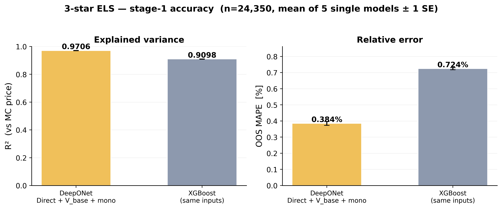

# 오토콜 ELS 이론가 DeepONet 대리모델 (Surrogate Pricing)

한국형 **3-기초자산 worst-of 스텝다운 오토콜 ELS**의 **몬테카를로 이론가**를 재현하는
연산자학습(operator-learning) 대리모델이다. 재시뮬레이션(10만 경로) 대비 **1,240배**(200개 요청)
~ **36,500배**(북 전량 일괄) 빠르게 가격을 산출한다 — 실측값이며 배치 크기에 좌우된다.

금융감독 공시(DART)와 시장데이터로 학습하고, 정보누수 없는 **walk-forward** 프로토콜로
표형 머신러닝 벤치마크와 비교 평가한다.

---

## 무엇을 예측하는가

타깃은 공시 공정가치가 아니라 **MC 이론가**다. 정본 라벨은 `mc_B`
(`tools/build_mc_variants.py`)이고, 엔진은 `module/mc_engine.py` 의 일별 GBM +
촐레스키 기하 worst-of 이며 **무보정(k = 1)** 이다 — 변동성 프리미엄 보정을 탐색했으나
근거·통용성이 약해 기각했다.

| 입력 | 현행 정의 | 구현 |
|---|---|---|
| 변동성 | 6개월(120 영업일) EWMA, λ = 0.99 | `module.features.vol_ewma_lam` |
| 상관 | KRX 영업일 120일 창, **쌍별** Pearson | `module.features.corr_bd` |
| 금리 | CD 91일 + IRS par 부트스트랩 제로커브 (드리프트·할인 양쪽) | `module.curve` |
| 배당 | **연속 배당수익률 q** (LSEG 일별 지표, 지수는 추종 ETF) | `module.dividend` |
| 경로 | **100,000** (공통난수 `mc_seed`) | `module.mc_engine.mc_daily_t` |

대리모델은 이 가격을 forward 한 번으로 재현한다. 프라이서와 **같은 입력**
(바스켓 vol·corr + KRW 곡선 + 전체 계약)을 받아 µs 단위로 추론한다.

> **1단계 성능은 MC 이론가 재현만으로 잰다.** 시장 공정가 지표는 섞지 않는다.

---

## 결과



3스타 ELS 시험구간 **24,350건**, 시드 5개 × 폴드 4개. 막대는 단일 모형 5개의 평균이고
오차막대는 같은 시드들의 표준오차다 (앙상블이 아니다).

| | R² | MAPE | MAE | RMSE |
|---|---:|---:|---:|---:|
| **DeepONet** (Direct + V_base + 단조) | **0.9706** ± 0.0011 | **0.384%** | 37.1원 | 62.2원 |
| XGBoost (같은 입력) | 0.9098 ± 0.0013 | 0.724% | 69.5원 | 109.0원 |

**같은 입력에서 아키텍처만 바꾼 비교다.** 두 모형 모두 곡선 u0-9 + vol·corr + 전체 계약을
받는다. R² 로 6.1포인트, 상대오차로 **1.9배** 차이가 난다.

**기울기도 같이 본다.** 수준 지표만으로는 부족하다. 계약조건을 흔들었을 때 가격이
MC 참값과 같은 기울기로 반응하는지를 따로 잰다.

**정본은 전수 횡단면 OOS 잔차회귀**다(`result/statistics/xsec_slope.csv`). 참값 기울기가
유의한 16행에서 기준 모형의 평균 |배수 − 1| = **0.114**, MC 참값과의 기울기 상관 **0.995**.
참값 기울기가 0 근처인 요인은 배수의 분모가 폭발하므로 거기서는 배수가 아니라 기울기
수준으로 읽어야 한다.

섭동 격자(`allstar_slope.csv`)도 함께 내지만 **기준상품이 스타당 12개**라 모형 간 순위를
가르기에는 표본이 부족하다. 두 통계는 일부 요인에서 **부호가 엇갈리는데**, 격자는 계약을
직접 흔든 인과적 측정이고 횡단면은 교란(위험한 상품일수록 쿠폰이 높다)을 포함하기 때문이다.
같은 것을 재는 두 수치가 아니므로 섞어 읽지 않는다.

전체 7종 비교와 1·2스타 확장은 `result/statistics/allstar_level.csv` 와
`result/image/allstar.png` 에 있다.

### 속도

`3_visualization` 3-5절 실측 (RTX 3060 Ti · 같은 3스타 OOS 200개 · **가격 산출만**).

| | 상품당 | MC 10만 대비 |
|---|---|---|
| **MC 100,000 경로** (정본 라벨) | 66.1 ms | — |
| MC 40,000 경로 | 27.5 ms | — |
| 대리모형 (200개 요청) | 53.3 µs | **약 1,240배** |
| 대리모형 (전량 29,916개 일괄) | 1.8 µs | **약 36,500배** |

배속은 배치 크기에 크게 좌우된다 — 200개 요청은 호출 오버헤드가 지배하고 큰 배치에서는
분산된다. 시장입력 조립(EWMA·상관·커브 부트스트랩·배당)은 두 경로 모두 똑같이 필요하므로
측정에서 제외했다.

**비교 기준은 정본과 같은 10만 경로다** — 대리모형이 재현하려고 배운 가격이 그것이기 때문이다.
4만 경로를 기준으로 삼으면 배속이 2.4배 과소평가되고, 배운 적 없는 더 시끄러운 가격과
비교하게 된다. 가격 일치는 corr 0.981 · MAE 43.0원 · RMSE 74.5원 · MAPE 0.45%.

**측정 프로토콜은 비대칭이다** — MC 는 1회 측정, 대리모형은 워밍업 3회 뒤 20회 중위값이다.
µs 단위 결론은 바뀌지 않지만 배속 수치는 그 비대칭 위에 있다.

지표: `result/statistics/` · 그림: `result/image/`.

---

## 기준 모형의 입력 스키마 — `ball_dm` (Direct+f+m)

위 그림의 **DeepONet** 이 이 모형입니다. Direct 타깃 계열에서 가장 좋습니다.

| 모집단 | n | R² | MAPE |
|---|---:|---:|---:|
| 3스타 (위 그림) | 24,350 | 0.9706 ± 0.0011 | 0.384% |
| 전체 (1·2·3스타) | 29,916 | 0.9739 ± 0.0006 | 0.384% |

`ball_d`(전체 0.9554)와 **같은 타깃·같은 손실**이고, 차이는 입력에 `V_base` 한 열을
더한 것뿐입니다. 아래는 그 입력을 하나씩 뜯어본 것입니다.

```
가중치  result/models/ball_dm_deeponet_anchor_seed{0..4}_fold{0..3}.pt
학습    module.train.train_curve_mono
신경망  module.networks.CurveOperatorV2
타깃    mc_B (MC 이론가, 액면 1 기준) — 잔차 아님
```

---

### 입력 세 블록 + 1

예측 한 건에 들어가는 것은 **72개 실수**입니다.

| 블록 | 차원 | 들어가는 것 |
|---|---:|---|
| `CURVE` | 10 | 제로금리 곡선 |
| `VC` | 10 | 변동성·상관·배당 |
| `CON` | 51 | 계약 조항 |
| `V_base` | 1 | 해석적 근사가 (이 모형만) |

`CON` 뒤에 `V_base` 를 붙여 **trunk 입력이 52차원**이 됩니다.
`ball_d` 는 이 열이 없어 51차원입니다.

세 블록 모두 **학습구간 통계로 z-정규화**합니다
(`zstats(..., tr)` — 시험구간을 보지 않습니다).

---

### ① `CURVE` (10) — 제로금리 곡선

발행일 KRW 제로금리를 만기 10점에서 샘플한 것입니다.

```
만기(년) = 0.25, 0.5, 1, 1.5, 2, 3, 4, 5, 7, 10
```

CD 91일물 + IRS par 금리를 부트스트랩한 커브에서 읽습니다
(`module.curve`). 드리프트와 할인 양쪽에 쓰이는 그 커브입니다.

> 이 블록만 **1D-CNN** 으로 처리합니다 — 곡선은 순서가 있는 신호이고,
> 인접 만기가 서로 강하게 묶여 있기 때문입니다.

---

### ② `VC` (10) — 시장 상태

| 위치 | 내용 |
|---|---|
| 0–2 | 기초자산 변동성 3개 (**오름차순 정렬**) |
| 3–5 | 쌍별 상관 3개 (**오름차순 정렬**) |
| 6 | `sig_eff` 바스켓 실효 변동성 |
| 7–9 | 연속 배당수익률 q 3개 (σ 정렬을 따라감) |

**왜 정렬하는가.** worst-of 페이오프는 기초자산의 **순서를 구분하지 않습니다.**
1·2·3번 자산의 라벨을 바꿔도 가격은 같습니다.
정렬해 넣으면 그 대칭성을 신경망이 배우지 않아도 되므로,
같은 자료로 더 쉬운 문제를 풉니다.

`sig_eff` 는 바스켓을 단일 자산처럼 본 실효 변동성입니다.

```
sig_eff = mean(σ) × sqrt(1 + max(0, 1 − mean(ρ)))
```

상관이 낮을수록 커집니다 — worst-of 에서 "하나라도 빠질" 확률이
커지는 효과를 한 숫자로 담습니다.

---

### ③ `CON` (51) — 계약 조항

| 위치 | 이름 | 내용 |
|---|---|---|
| 0–11 | `strk_0..11` | 회차별 행사가 (조기상환 배리어) |
| 12–23 | `pmt_0..11` | 회차별 **누적** 지급률 |
| 24–35 | `lz_barr_0..11` | 리자드 배리어 |
| 36–47 | `lz_pmt_0..11` | 리자드 지급률 |
| 48 | `BARR_1/100` | KI 배리어 |
| 49 | `ANL_RTRN/100` | 연 쿠폰 |
| 50 | `TENOR` | 만기(년) |

회차가 12보다 적으면 남는 자리는 중립값으로 채웁니다.
리자드가 없는 상품은 `lz_barr = 1.2`(중립) 이고,
이 값이 **"리자드 없음" 의 표식**으로도 쓰입니다.

`BARR_1/100 >= 1.0` 은 "항상 낙인"(노낙인 아님) 을 뜻합니다.

---

### ④ `V_base` (1) — 이 모형을 가르는 한 열

**무엇인가.** worst-of 바스켓을 단일 자산처럼 근사해
**닫힌식으로 계산한 간이 가격**입니다. 시뮬레이션이 없습니다.

```
V_base = Σ_j (C_{j-1} − C_j)(1 + pmt_j) · DF(θ_j)
       + C_K · DF(T) · [ p_KI · E[w_T | w_T < b_K] + (1 − p_KI) · 1.0 ]
```

`module.vbase` 가 논문 식 19를 우리 ELS 에 이식한 것이고,
우리 MC 의 실제 페이오프에 맞춰 세 곳을 바꿨습니다.

| | 원문 | 우리 |
|---|---|---|
| 만기 비상환·미낙인 | `1 + cT` | **원금 1.0** |
| 만기 손실 분기 | `w_0` 로 대체 | **절단 로그정규 평균** `E[w_T │ w_T < b_K]` |
| `B >= 1.0` | — | `p_KI = 1` (항상 낙인) |

**왜 도움이 되는가.** `V_base` 는 **배당을 본 값**입니다.
그런데 배당수익률 q 는 `VC` 에만 있고 `CON` 에는 없습니다.
`V_base` 를 trunk 에 넣으면 계약 쪽에서도 배당이 반영된 기준선을
보게 되어, 모형이 "구조를 처음부터" 배울 필요가 줄어듭니다.

실측으로 `ball_d` 0.9554 → `ball_dm` 0.9739 입니다.

> `V_base` 는 **입력(피처)** 으로만 쓰고 타깃에서 빼지 않습니다.
> 빼는 쪽이 `Resid+f+m`(0.9788)이고, 그건 Direct 계열이 아닙니다.

---

### 신경망 구조

```
CURVE(10) ─ 1D-CNN ─┐
                     ├─ branch MLP ─→ (P=192)
VC(10) ─────────────┘                    │
                                         ⊙ 내적
CON(51) + V_base(1) ─ trunk MLP ─→ (P=192)
                                         │
                                      + b0 → 가격
```

DeepONet 규약 그대로입니다 — **branch 가 시장 상태**,
**trunk 가 계약**, 두 잠재벡터의 내적이 가격입니다.

같은 시장에서 계약만 바꿔가며 견적을 낼 때
branch 를 재사용할 수 있는 구조입니다.

```
P = 192 · MLP 폭 128 · 반복 3,000 · 배치 512 · lr 1e-3
```

---

### 단조손실 (`+m`) — 부호를 손실로 강제

금융 상식상 **방향이 확실한** 계약 변화가 있습니다.
가격이 그 반대로 움직이면 벌점을 줍니다.

**작동 방식.** 배치마다 계약을 한 가지씩 흔들어
원본과 **함께 forward** 한 뒤, 부호가 틀린 만큼만 더합니다.

```python
viol = relu(margin − 기대부호 × (흔든가격 − 원가격)) × 적용마스크
mono_loss = viol.sum() / 적용마스크.sum()
```

`relu` 이므로 **방향이 맞으면 벌점 0** 입니다.
맞는 쪽을 더 밀어붙이지 않고, **틀린 것만** 교정합니다.

#### 흔드는 다섯 방향

| 항목 | 흔드는 폭 | 기대 부호 | 적용 대상 |
|---|---|---|---|
| `coupon` | +0.005 (쿠폰·누적지급률 같은 비율로) | **+** | 전체 |
| `strike` | +0.02 (12회차 전부) | **−** | 전체 |
| `barrier` | +0.02 (KI 배리어) | **−** | `B < 0.99` 인 낙인형만 |
| `lz_pmt` | ×1.25 (리자드 지급률) | **+** | 리자드 있는 회차만 |
| `lz_barr` | +0.02 (리자드 배리어) | **−** | 리자드 있는 회차만 |

**적용마스크가 중요합니다.** 리자드가 없는 상품에 리자드 조항을 흔들어봐야
가격이 변할 이유가 없습니다. 그런 상품은 분모에서 빠집니다
(`lz_barr < 1.2` 인 회차가 하나라도 있어야 포함).

#### 기준 모형의 설정

```python
MONO = dict(fixed_w=1.0, kinds=["lz_pmt"], margin_krw=8.0)
```

| 항목 | 값 | 이유 |
|---|---|---|
| `kinds` | `["lz_pmt"]` **하나만** | 기준 모형이 유일하게 위반하던 항목 |
| `margin_krw` | **8.0원** | 부호만이 아니라 **최소 반응 크기**를 요구 |
| `fixed_w` | **1.0** 고정 | 자동 산정은 `ml→0` 에서 폭발 |

**왜 다섯 개를 다 걸지 않는가.** 나머지 넷은 손실 없이도 부호가 맞았습니다.
맞는 것에 손실을 걸면 데이터손실과 경쟁만 시킬 뿐 얻는 것이 없습니다.
**위반하는 항목에만** 겁니다.

**`margin_krw` 가 하는 일.** 0이면 "부호만 맞으면 통과" 라서
리자드 지급률을 1.25배 올려도 가격이 0.01원만 올라가면 넘어갑니다.
8원을 요구하면 **반응의 크기**까지 강제합니다 — 기울기를
MC 참값에 맞추려는 장치이고, 그래서 기울기 지표를 따로 봅니다
(`result/statistics/xsec_slope.csv`).

**MC 라벨을 더 만들지 않습니다.** 흔든 입력에 대한 MC 참값은 없습니다.
"부호가 뒤집히면 안 된다" 는 사전 지식만 쓰므로 추가 계산이 없습니다.

---

### 예측 한 건 만들기

```python
from module import star as ST, train as TR

D  = ST.make_all()                 # CURVE · VC · CON · MC
vb = ST.vbase_all(D)               # V_base (1열)
Dx = copy.copy(D)
Dx.CON = np.concatenate([D.CON, vb[:, None]], 1)   # 51 → 52

f = TR.load_curve_forward("result/models/ball_dm_deeponet_anchor_seed0_fold0.pt")
price = f(Dx.CURVE[[i]], Dx.VC[[i]], Dx.CON[[i]])  # 액면 1 기준
```

**시드 5개의 평균을 쓰십시오.** 단일 시드로 순위를 말하지 않습니다 —
신경망 시드 간 흔들림이 R² 0.0006 수준으로 작긴 하지만,
보고하는 모든 수치는 5시드 평균 ± SE 입니다.

---

## 레포 구조

```
config.yaml              # 모든 하이퍼파라미터의 단일 출처
0_data_preprocessing.ipynb  # raw + cache -> data/els3_dataset.parquet + 탈락 퍼널 · 분포 · 시계열
1_MC_pricer.ipynb           # 현행 방법론 프라이서: 시장입력 · 비트단위 재현검증 · 경로잡음
2_model_training.ipynb      # 대리모형 학습(1·2·3스타 통합 / 3스타 전용) + OOS 수준 지표
3_visualization.ipynb       # 그림 일체 4개 범주: 스타별 성능 · 계약조건 반응 · 프라이서 · 상품

model/                   # 모델 플러그인(레지스트리 자동발견): benchmark, deeponet, _template
module/                  # 데이터 + 특성/MC 엔진 + 네트워크 + 학습 + 추론
util/                    # file_manager(경로), utils(설정/시드), metric, plot, speed
data/                    # cache/ 와 raw/ 만 추적 대상 입력(아래 참고)
result/                  # predictions/, image/, statistics/, models/(폴드별 저장 가중치)
paper/                   # 참고 논문 [1]-[5]
```

### 데이터 — 추적 대상 vs 재생성 대상

입력은 **원천 두 곳뿐**이다. `data/cache/` 는 입력이 아니라 **산출물**이며, `data/` 의 나머지도 파생물로
git-ignore 된다. 이 구분은 실제로 검증했다 — 캐시·가중치·결과표를 전부 치우고 원천만 남긴 상태에서
노트북 4장이 전 과정을 다시 만든다.

- `data/raw/` — DART 공시 CSV(`AUTO_CALL`, `SCHD_INFO`, `UDLY_INFO`) · `rates/` 금리커브 3파일
  (CD 91일 · IRS par · NS 노드) · `udly_ticker_map.json`. **git-ignore**(>100 MB); 로컬 보관.
- `data/share_underlyings_v2/` — 기초자산 187 CSV(일별 종가 + 배당수익률) + `master.csv`.
  가격은 `Close_Adj`(액면분할만 조정)를 쓴다. 엔진이 배당을 드리프트에서 따로 빼므로
  배당 역조정 계열을 쓰면 이중계산이 된다.
- `data/cache/` — **산출물.** MC 라벨(`mcvar/mc_variants*.parquet`), 프록시 `V_base`, 중간 매핑.
- `data/els3_dataset.parquet`, `els12_dataset.parquet`, `ml.csv`, `deeponet.csv` — 노트북 0 이 **재생성**.

---

## 재현 — 원천 자료만 있으면 노트북 4장으로 끝난다

```bash
pip install -r requirements.txt          # Python 3.11 (conda env `abacus`)

jupyter nbconvert --to notebook --execute --inplace 0_data_preprocessing.ipynb
jupyter nbconvert --to notebook --execute --inplace 1_MC_pricer.ipynb
jupyter nbconvert --to notebook --execute --inplace 2_model_training.ipynb
jupyter nbconvert --to notebook --execute --inplace 3_visualization.ipynb
```

별도 CLI 단계는 없다. 각 노트북이 자기 산출물을 만들고, **이미 있으면 건너뛴다**.

| 노트북 | 만드는 것 | 실측 비용 |
|---|---|---|
| **0** | `els3_dataset.parquet`(59,037) · `els12_dataset.parquet`(15,752) · `ml.csv` · `deeponet.csv` · 그림 3 | 약 3분 |
| **1** | `mc_variants12`(1·2스타 15,752) · `mc_variants`(3스타 59,037) · `mc_check_allstar` · `mc_boot_curve_200` | **약 160분** |
| **2** | `models/` 가중치 140개(7종 × 5시드 × 4폴드) · `nb_training_level.csv` | 약 25분 |
| **3** | 그림 24장 · 표 13개 (헤드라인 · 7종 비교 · 전수 횡단면 기울기 · 속도) | 약 10분 |

다시 만들려면 노트북 0·1 은 `REBUILD = True`, 노트북 2 는 환경변수 `RETRAIN=1`
(라벨이 바뀌면 저장된 가중치는 낡는다).

**샤드 캐시는 더 필요하지 않다.** 종전에는 노트북 0 의 `mc` 열이 `data/cache/mccal_shard_*.json`
28개에 묶여 있었고 그게 없으면 단일코어 수 시간을 재시뮬해야 했다. 지금은 `module.data.build_datasets`
가 `mc`·`recent_margin` 열이 없어도 데이터셋을 만들고, 학습 라벨은 `module.mcvar` 가 `mc_B` 로
직접 공급한다. 그래서 원천만으로 0→3 이 끝까지 돈다.

모든 하이퍼파라미터는 **`config.yaml`**, 모든 경로는 **`util/file_manager.py`** 로 관리한다.
`combine` 단계만 분리돼 있는 것은 그것이 유일한 고비용 단계이기 때문이며, 그 외 노트북 0→3 은 위에서
아래로 순차 실행된다.

---

## 코드 맵

노트북은 **손으로 고치지 않는다.** `tools/build_nb_*.py` 가 생성하고, 노트북을 직접 편집하면
다음 생성 때 덮어쓰인다.

### `module/` — 파이프라인 본체

| 파일 | 역할 |
|---|---|
| `build_source.py` | DART 공시 → `els3_dataset.parquet` (적격 판정·탈락 사유 집계) |
| `underlying.py` | `share_underlyings_v2` 가격 어댑터 (`Close_Adj`, UDLY_ID 대체 해석) |
| `mc.py` | **가격 적재의 유일한 출처** `returns_by_ticker` · `PX_SOURCE` 전환 |
| `dividend.py` | **배당 소스의 유일한 분기** `div_kwargs` · 지수→ETF 프록시 |
| `curve.py` | CD + IRS par 부트스트랩 제로커브 |
| `features.py` | EWMA 변동성 · 영업일 쌍별 상관 · 곡선 노드 |
| `market.py` | 상품 하나의 시장입력 조립 (`state_for` → 엔진 kwargs `dkw`) |
| `mc_engine.py` | 일별 GBM 기하 worst-of (torch, GPU 벡터화) |
| `seeds.py` | 공통난수 시드 — `item` 해시 기반 (행 번호 아님) |
| `mcvar.py` | 라벨 적재 · `make_D` 가 `D.MC` 를 `mc_B` 로 공급 |
| `star.py` | 1·2·3스타 통합 (`make_all`) · `vbase_all` |
| `data.py` | `ml.csv` · `deeponet.csv` 생성 · 라벨 열 채움 |
| `train.py` | `train_curve_mono` — MSE + 단조 hinge |
| `networks.py` | `CurveOperatorV2` (branch=곡선 CNN+vol·corr, trunk=계약) |
| `vbase.py` | 준해석적 베이스 프록시 `V_base` (닫힌식) |
| `contract.py` | 계약 섭동 격자 (`GRID` · `apply_factor`) |

### `tools/` — 생성기와 검증 도구

| 파일 | 역할 |
|---|---|
| `build_nb_{data,pricer,training,viz}.py` | 노트북 0·1·2·3 생성기 |
| `build_mc_variants.py` | MC 라벨 산출 · 출처 스탬프(`stamp`·`step_stale`) |
| `eval_all_stars.py` | 7종 × 1·2·3스타 성능·기울기 · 헤드라인 그림 |
| `eval_cross_section.py` | 전수 횡단면 잔차회귀 기울기 |
| `verify_raw_run.py` | 원천 전용 재현 판정 (부분집합별 · 2표본 검정) |
| `freeze_verdict.py` | 판정 근거를 저장소 픽스처로 고정 |

### `util/`

`file_manager.py` 가 **모든 경로**를, `plot.py` 가 그림 규약(dpi 400 · 영어 · PPT 밴드)을 쥔다.
`metric.py` 는 R²·MAE·RMSE·MAPE·Bias·Spearman 를 한곳에서 계산한다.

---

## 설정 (`config.yaml`)

`seed`, `device`; `data.walk_forward` 폴드 경계 `[0.6,0.7,0.8,0.9,1.0]`(test = 미래 40%, 확장 4폴드),
`val_frac`, `time_decay`; `train`(연산자망 반복수 / lr / early stopping); `networks.P`(잠재차원);
표형 벤치마크용 `tabular` 트리 하이퍼파라미터(`xgb`/`lgbm`/`cat`/`gbm`/`ridge`).

---

## 참고문헌 (PDF 는 `paper/`)

1. Lu et al. "Learning nonlinear operators via DeepONet based on the universal approximation theorem of operators." *Nature Machine Intelligence* 3.3 (2021): 218–229.
2. Wang, Wang, Perdikaris. "Learning the solution operator of parametric PDEs with physics-informed DeepONets." *Science Advances* 7.40 (2021): eabi8605.
3. Lee, Huh, Jeong. "DeepONet-based surrogate modeling for bond option pricing." *AIMS Mathematics* 11.3 (2026): 5853.
4. Andreou, Han, Li. "Stock options pricing via machine learning methods combined with firm characteristics." (2023).
5. Jiao et al. "Solving forward and inverse PDE problems on unknown manifolds via physics-informed neural operators." *arXiv:2407.05477* (2024).
